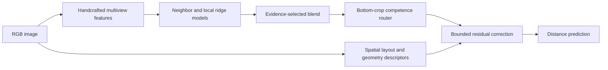

# Image Distance Estimation with Handcrafted Features

A constrained machine learning research project from ETH's Statistical Machine
Learning course: predict a scalar distance from an RGB image using handcrafted
visual features, local regression, and a learned competence router.

The interesting result is how local models and selective corrections interact:
adding a stronger visual signal globally did not always improve every distance
regime. The experiment record includes failed approaches as well as the selected
pipeline.

## Method



The active code uses NumPy and scikit-learn, with Pillow for image loading.
It does not directly use Torch, pretrained backbones, OpenCV, SciPy, or
scikit-image. **scikit-learn itself depends on SciPy**; the restriction here
refers to direct modeling/feature code, not a SciPy-free environment.

## Recorded results and limits

Lower mean absolute error (MAE) is better. These are historical results reported
in [the results record](docs/RESULTS.md), not measurements from CI.

| Pipeline | Reported public MAE | Recorded development OOF MAE |
| --- | ---: | ---: |
| Evidence-selected blend | 0.0966 | 0.100969 |
| Local-competence router | 0.0963 | 0.100420 |
| Confidence mixture (pipeline 10, historical comparison) | 0.0958 | 0.099990 |
| Geometry correction (pipeline 14, selected) | **0.0951** | 0.099819 |

Pipeline 14 improved the reported public score by 0.0007 over pipeline 10, with
a middle-distance OOF penalty. No leaderboard export, private-test result, rank,
or uncertainty estimate is included. Public-score-based selection can overfit
that leaderboard.

Base models use stratified out-of-fold (OOF) predictions. Later stacked layers
reuse global OOF predictions across the same folds: training meta-features can
therefore depend indirectly on labels in the outer validation fold. These are
**not fully nested estimates of the complete stack**. An untouched holdout or
nested evaluation is needed before generalization claims. See
[evaluation limitations](docs/REPRODUCIBILITY.md).

This is batch research software. Serving latency, operational monitoring,
deployment, and performance on new scenes have not been established.

## Quick start

Use Python 3.12 from the repository root:

```bash
python -m venv .venv
source .venv/bin/activate
python -m pip install -r requirements.txt -c requirements-lock.txt
python -m unittest discover -s tests -v
python -c 'import main; assert callable(main.main)'
python scripts/check_notebooks.py
```

Tests use synthetic images and labels; no competition access is needed. They
cover feature, fold, routing, image-ordering, and CSV contracts, not model
quality. CI runs the same checks.

To reproduce the selected experiment, obtain the dataset through the course's
authorized distribution, follow [data/README.md](data/README.md), then run:

```bash
python main.py
```

This launches the full pipeline, not a lightweight inference service or a CLI
with a quick flag. Outputs under `artifacts/` include
`full_pipeline_14_geometry_aware_distances_angles_prediction.csv`, summaries,
diagnostics, and OOF/test arrays. The dataset is not distributed here, and CI
does not run full training. Runtime and peak RAM have not been measured for
the documented environment.

## Explore the work

| Entry point | Purpose |
| --- | --- |
| `main.py` → `final_public_competence_pipeline.py` | Stable selected entry point |
| `pipeline_14_geometry_aware_distances_angles.py` | Geometry residual layer |
| `final_local_competence_pipeline.py` | Competence routing over the blend |
| `final_evidence_pipeline.py` | Evidence-selected base ensemble |
| `experiment_driver.py` | Feature, preprocessing, and model ablations |
| [EXPERIMENT_SUMMARY.md](EXPERIMENT_SUMMARY.md) | Ablations, tradeoffs, rejected hypotheses |
| [docs/RESULTS.md](docs/RESULTS.md) | Aggregate results and evidence provenance |
| `tests/` | Small data-free contract checks |

The public source contains the selected pipeline and its dependencies. Historical
comparisons are retained as aggregate research results; their superseded scripts
are not distributed here. Do not commit dataset images, labels, generated
predictions, caches, or executed notebook outputs.

## Publication and reuse

No open-source license has been selected. Public visibility allows inspection;
it does not itself grant general reuse rights.
